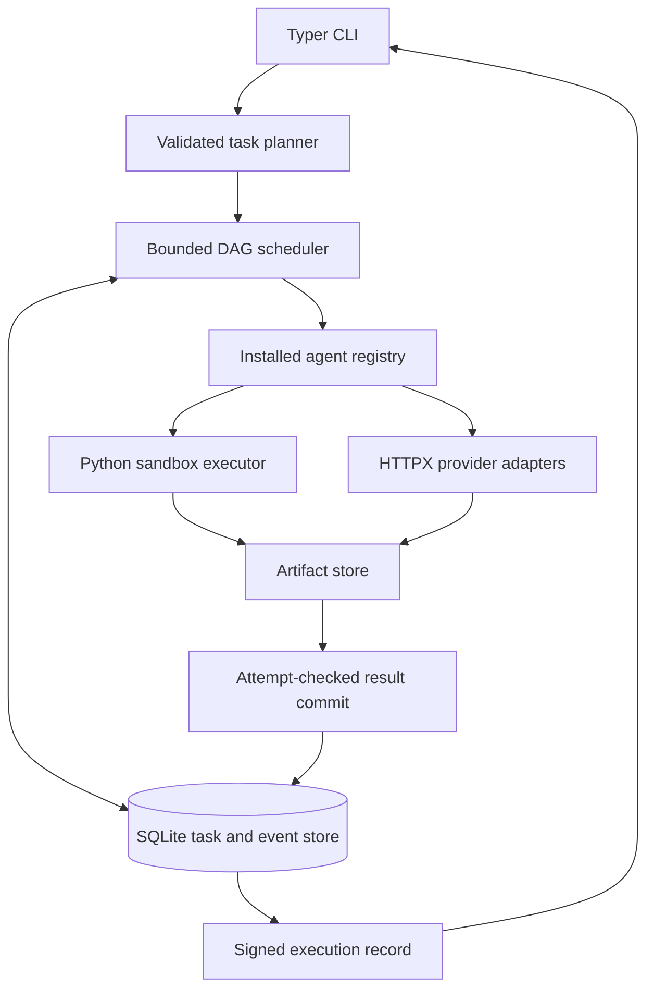

# Nexus Python Runtime — Revised Design

**Status:** Proposed; implementation not started.
**Date:** 2026-10-20
**Supersedes:** `2026-10-20-nexus-multi-agent-system-design.md`.
**User requirements:** Replace Rust with Python; address scalability gaps; prepare implementation plan using Superpowers.
**Assumption:** First release targets a local, single-user CLI. Shared-server and distributed deployments require a later design.

## 1. Outcome and scope

Build an orchestration runtime that actually executes agent tasks, passes dependency outputs, bounds resource use, and resumes interrupted runs.
Success means verified execution behavior, not merely successful routing or a valid signature.

First release supports Python code generation/execution, text synthesis, and processing explicitly supplied input files.
Research means synthesis of supplied sources; live browsing is outside this release.
Ops produces advisory text only. Shell execution, deployments, remote plugins, and external side-effect tools are excluded.
Agent manifests describe installed Python implementations; this registry does not install or execute arbitrary third-party packages.

Existing workspace contains a Rust manifest, error module, and scaffolding test. Preserve these during Python implementation.
Use repository root for Python packaging and `src/nexus/` for Python modules; do not create a nested repository.
Remove legacy Rust files only through a separately authorized cleanup.

## 2. Stack and alternatives

| Concern | Selected stack | Decision |
|---|---|---|
| Language | CPython 3.12; `requires-python = ">=3.12,<3.13"` initially | Pin supported minor; test and expand deliberately |
| Packaging | uv, `pyproject.toml`, `uv.lock`, Hatchling | Reproducible installation and CLI entry point |
| Concurrency | Standard-library asyncio: TaskGroup, Queue, Semaphore, timeout | Bounded I/O concurrency; explicit cancellation |
| Models/config | Pydantic 2, pydantic-settings 2 | Validate plans, policies, provider output; reject unknown fields |
| CLI | Typer | `nexus` entry point with JSON output option |
| Durable state | SQLite WAL, aiosqlite, numbered SQL migrations | Local task state, attempts, events, artifact metadata |
| Artifacts | Private local files, hashlib SHA-256 | Keep large data out of task rows and event payloads |
| LLM access | HTTPX AsyncClient; explicit provider adapters | Pooled connections, bounded responses, timeout control |
| Sandbox | Bubblewrap, delegated cgroup v2, isolated Python launcher | Linux code execution; fail closed if prerequisites fail |
| Receipts | cryptography Ed25519; deterministic JSON envelope | Persistent trusted signing identity and artifact verification |
| Logs | Standard-library logging with JSON formatter | Run/task/attempt correlation; no prompt or secret logging |
| Tests/checks | pytest, pytest-asyncio, Hypothesis, HTTPX MockTransport, Ruff, mypy | Behavioral, property, failure, and load checks |

Resolve compatible current package releases during implementation, commit `uv.lock`, and run CI with `uv sync --frozen`.
Do not claim compatibility from unconstrained package names or the old Rust minimum version.

Considered alternatives:

1. **Selected: Python + SQLite local runtime.** Lowest operational burden; one active orchestrator per state directory.
2. **Python + PostgreSQL service.** Appropriate when shared access or concurrent orchestrators become requirements; adds deployment and authentication work.
3. **Distributed durable workflow platform.** Consider when workers span machines and long-running workflow operations justify another service.

Asyncio suits concurrent provider requests. CPU-heavy generated programs execute in separate constrained processes.
Python selection does not itself prove throughput. SQLite supports one writer at a time and WAL requires a local filesystem.
Use short transactions and measure scheduling overhead before changing databases.

## 3. Architecture

One orchestrator owns one state directory using a nonblocking OS advisory lock. Hold lock for execution, resume, and pruning.
Concurrent mutating invocations fail with `StateDirectoryBusy`; status queries remain readable.
Several runs may exist on disk, but one run executes per state directory in v1.

SQLite is authoritative. In-process notifications only wake readers; persisted event sequence numbers support catch-up.
No task depends on receiving every notification.

## 4. Fixed defaults and admission limits

These are proposed limits and test targets, not measured production capacity.

| Setting | Default / hard admission limit |
|---|---|
| DAG size | 100 tasks, 500 dependency edges |
| Active task attempts | 8 |
| Ready queue | 32 IDs; remaining ready tasks stay in SQLite |
| Provider concurrency | 2 per provider |
| Provider request rate | 30 starts per rolling 60 seconds per provider |
| Run provider budget | 100 HTTP attempts, including planning, repair, and retries |
| Total task attempts | 3, including initial attempt, failover, and healing |
| HTTP connect / pool timeout | 5 seconds each |
| HTTP read / write timeout | 30 seconds each |
| Whole HTTP attempt | 45 seconds |
| Task attempt / run deadline | 120 seconds / 30 minutes |
| Code execution wall time | 30 seconds |
| Sandbox memory / process cap | 512 MiB / 64 processes |
| Sandbox CPU bandwidth | One CPU equivalent |
| Captured stdout / stderr | 1 MiB each |
| Provider response body | 1 MiB |
| Inline task input / artifact | 64 KiB / 10 MiB |
| Per-run artifact budget | 100 MiB |
| Managed storage budget | 1 GiB; reject admission before exceeding reserved capacity |
| Successful-run retention | 7 days; explicit `prune` only |
| Failed/interrupted runs | Retained until explicit deletion; count against quota |
| Shutdown cleanup allowance | 5 seconds after cancellation |

Every limit has a typed configuration field and validation. Reject zero/negative concurrency and contradictory limits.
Persist resolved policy with each run. Resume uses that policy; policy changes require a new run.
Provider-specific rate limits can be lower than defaults. Shared API-account limits across other applications are outside local enforcement.

## 5. Contracts and state machine

Use Pydantic models with `extra="forbid"` and strict validation of scalar fields.
IDs are UUID strings generated by host; planner-local node labels are remapped to UUIDs after validation.

- `TaskSpec`: task ID, description, required capabilities, preferred capabilities, dependency IDs, declared input artifact IDs.
- `ExecutionPlan`: schema version, tasks, terminal result IDs.
- `TaskContext`: run ID, task ID, attempt ID, attempt number, absolute deadline, immutable dependency outputs.
- `AgentManifest`: ID, version, required runtime, capabilities, maximum concurrency, output kind.
- `AgentOutput`: discriminated union of text or Python source, plus artifact references.
- `ArtifactRef`: artifact ID, SHA-256, byte count, media type, run/task/attempt ownership.
- `ExecutionRecord`: input/code/output digests, agent/provider/model IDs, attempt status, timing, sandbox policy/result.
- `RunReport`: run ID, terminal status, ordered terminal artifacts, failures, actual request/attempt counts.
- `RuntimePolicy`: all limits in section 4 and provider/model selection.

Task states: `pending -> ready -> running -> succeeded`.
Other transitions: `running -> retry_wait -> ready`, `running -> failed`, and nonterminal states to `cancelled`.
Failed dependencies make descendants `blocked`; independent branches may finish.
Run succeeds only when all required terminal tasks succeed and no required ancestor fails.
Any required failure yields a failed run and nonzero CLI exit.

Store unique `(run_id, task_id, attempt_number)` and current attempt ID on task row.
Commit result only when attempt ID matches current running attempt; stale results cannot overwrite state.
Result publication, task transition, and event insertion occur within one transaction.

## 6. Persistence, artifacts, and recovery

Tables: schema migrations, runs, tasks, edges, attempts, artifacts, events, provider_requests.
Index runnable states/deadlines, dependency lookups, event sequence, artifact ownership, and provider request timestamps.
Enable foreign keys, WAL, `synchronous=FULL`, and 5-second busy timeout.
One aiosqlite write connection plus application transaction lock prevents coroutine transactions from interleaving.
Use a separate read connection. Never hold a transaction during network access or sandbox execution.

Persist complete validated plan before execution. Persist attempt start and budget reservation before external work.
Import explicit input files by copying regular files into managed artifacts; never mount arbitrary source paths in sandbox.
Reject symlinks, path traversal, device files, excessive input size, and unstable copies detected by source metadata checks.
Hash and write artifacts to temporary files, fsync, atomically rename, then commit metadata.
Disk-full or metadata failure cannot mark task successful. Recovery removes unreferenced temporary files.
Pruning obtains orchestrator lock and removes only unreferenced artifacts belonging to eligible terminal runs.
Events contain references and status, not full generated outputs. Bound diagnostic messages to 4 KiB.
Reserve run storage at admission; before each write enforce artifact and run caps. Stop work on storage exhaustion.
Release unused reservation when run becomes terminal; retained bytes still count toward managed storage quota.
On reopen, reconcile reservations against durable run state and measured managed files before admitting new work.

On resume:
1. Acquire state-directory lock.
2. Reap recorded sandbox cgroups and confirm they are empty before new attempts start.
3. Mark previously running attempts interrupted; never infer success from loose files.
4. Requeue interrupted tasks only within their original deadline and remaining attempt/request budgets.
5. Preserve succeeded nodes and reconstruct runnable dependencies from SQLite.

Recovery is at-least-once computation with at-most-one accepted result per task.
Repeated HTTP requests may incur provider charges after ambiguous failures; never promise exactly-once provider execution.

## 7. Planner, routing, providers, and budgets

Support explicit `--plan plan.json` for deterministic workflows and natural-language planning through configured provider.
Planner returns JSON matching ExecutionPlan; reject cycles, duplicate labels, unknown dependencies, oversized graphs, and invalid terminal nodes.
One malformed planner result may be repaired once; both HTTP attempts count toward run budget.
Mock mode provides deterministic fixture plans and responses. Never silently fall back from real provider to mock.

Worker selection requires every mandatory capability. Rank eligible workers by preferred matches, free capacity, then stable worker ID.
Record failures by task attempt; an invalid task does not globally disable a worker.
Bind manifests to actual installed Agent instances, not detached catalog entries.
Pass only declared inputs and successful dependency outputs. Agents never publish directly to global shared keys.
Final aggregation produces ordered terminal outputs; synthesis is an explicit dependent task.

Implement OpenAI-compatible chat-completions and Anthropic messages as separate adapters.
Configure provider, model, endpoint, and credential source explicitly. HTTPS required except loopback test servers.
Reuse AsyncClient, disable redirects, redact credentials, and cap streamed response bytes before JSON parsing.
Adapters report classified errors and usage when available. HTTP retries belong to scheduler budget, not hidden client loops.
Retry transport failures, 429, and 5xx within remaining deadlines. Respect bounded Retry-After.
Use exponential backoff of 1, 2 seconds plus 0–250 ms jitter for remaining task attempts.
Authentication/configuration failures terminate immediately. Invalid generated code uses remaining task attempts for healing.
Reserve every HTTP attempt transactionally. Preserve rolling-window request timestamps on resume.

## 8. Sandbox and healing

Linux execution requires Bubblewrap, user namespaces, and a writable delegated cgroup v2 subtree with memory, pids, and CPU controllers.
Preflight also checks cgroup kill support. Missing enforcement produces `SandboxUnavailable`; no production unconfined option exists.
Non-Linux hosts may plan and run text-only tasks; code execution fails explicitly.

Dedicated launcher process joins attempt cgroup before executing Bubblewrap. Do not use unsafe `preexec_fn` hooks in asyncio process creation.
Apply `memory.max`, `memory.swap.max=0`, `pids.max`, and `cpu.max` before releasing launcher.
Bind only runtime directories `/usr`, `/bin`, `/lib`, and `/lib64` when present; resolve required interpreter paths during preflight.
Use fresh `/proc`, minimal `/dev`, tmpfs `/tmp` and work directory, read-only declared inputs, and no host root mount.
Private home, host `/etc`, credentials, repository, state directory, and signing key remain outside mounted paths.
Clear environment; allowlist PATH, locale, and Python settings. Disable network, drop capabilities, and set no-new-privileges.
Sandbox takes source as an input file, not shell command interpolation. Execute Python with isolated mode.
Outputs are bounded stdout/stderr only in v1; arbitrary filesystem exports are excluded.

Read both pipes concurrently in bounded chunks. Exceeding either cap kills entire cgroup and records `OutputLimitExceeded`.
On deadline/cancellation, terminate cgroup processes, escalate to cgroup kill within 5 seconds, await exit, then remove cgroup.
On orchestrator crash, enforce remaining cleanup during resume before dispatch.
Kernel sandboxing is not a tenant isolation service; hostile multi-tenant workloads require a separately reviewed VM boundary.

Heal nonzero program exits only. Warnings on stderr with exit zero do not trigger healing.
Infrastructure failures, resource violations, and cancellation do not request an LLM repair.
Return final source digest and execution output together, preserving all attempt records.
Sandbox success means process success; task-specific result validators remain necessary for semantic correctness.

## 9. Receipts and operator interface

Create persistent Ed25519 key with exclusive creation and owner-only permissions during `nexus init`.
Explicit trust file maps key IDs to public keys. Verification never trusts a key embedded in receipt alone.
Sign UTF-8 JSON using fixed field schema, sorted keys, compact separators, and domain prefix `nexus-receipt-v1:`.
Exclude floats and NaN; timestamps use UTC strings, durations use integer milliseconds.
Receipt binds run ID, task records, resolved policy hash, input/output digests, terminal status, and signing key ID.
Verify signature against trust file and recompute every referenced supplied artifact digest.
Report missing artifacts as incomplete verification, not verified execution.
Signed failure receipts describe failures; signatures attest host records, not model truth or independent proof of execution.

CLI:
- `init`, `doctor`, `list-agents`
- `run TASK --provider ... --model ...` or `run --plan FILE`
- `run TASK --mock-llm`, `run TASK --dry-run`
- `status RUN_ID`, `resume RUN_ID`, `prune --older-than-days 7`
- `verify-receipt FILE --trust-file FILE --artifact-dir DIR`

`--state-dir` isolates tests and projects. `--json` emits schema-versioned machine-readable responses.
Dry-run may call planner provider but never invokes worker agents or sandbox; disclose provider use in output.
Without credentials, real execution fails configuration validation. Mock flag is explicit.
Exit codes: 0 success, 1 execution/verification failure, 2 invalid configuration/input, 130 interruption.
SIGINT cancels scheduling, cleans children, persists cancellation, and releases lock.

## 10. Verification and scale gates

Required behavior: dependency ordering, 8-attempt bound, provider limits, retry budget persistence, isolation between task outputs,
stale attempt rejection, restart recovery, failed dependency blocking, sandbox resource enforcement, and receipt tampering rejection.
Test actual CLI subprocesses. Unconfined fakes do not satisfy sandbox acceptance.

Load target on documented Linux host with at least 4 CPU cores and 8 GiB RAM:
100-node synthetic-executor DAG, 8 active slots, 32 queued IDs, 64 KiB outputs; repeat 20 runs.
This benchmark measures orchestration without provider calls; provider rate/budget behavior has separate integration tests.
Measure control-process peak RSS, scheduling latency excluding execution/backoff, total duration, queue depth, DB write latency, and retries.
Provisional gates: control-process RSS <256 MiB; p95 eligible-task dispatch <100 ms when capacity is available.
No increasing retained-memory trend across repeated completed runs after cleanup.
Report sandbox memory separately; two 512 MiB child limits do not fit inside a 256 MiB controller budget.
Actual throughput and machine details must be recorded; these targets are not existing benchmark results.

Future shared-server trigger: multiple users need simultaneous runs or authenticated remote access.
Future distributed trigger: workers must span hosts or local scheduling capacity fails measured requirements.
Then evaluate PostgreSQL task claims with leases/fencing, object storage, authenticated worker transport, tenant quotas, and API service.
SQLite-to-PostgreSQL migration requires schema/data migration and contract tests; replacing an adapter alone is insufficient.

## 11. Documentation basis

Design choices are recommendations based on current workspace and these primary references:

- [Python asyncio task groups and cancellation](https://docs.python.org/3.12/library/asyncio-task.html)
- [aiosqlite execution model](https://aiosqlite.omnilib.dev/en/stable/)
- [SQLite WAL concurrency and filesystem limits](https://www.sqlite.org/wal.html)
- [HTTPX timeout controls](https://www.python-httpx.org/advanced/timeouts/)
- [Pydantic strict validation](https://pydantic.dev/docs/validation/latest/concepts/strict_mode/)
- [uv projects and lockfiles](https://docs.astral.sh/uv/guides/projects/)
- [Bubblewrap security model](https://github.com/containers/bubblewrap)
- [Linux cgroup v2 resource controls](https://www.kernel.org/doc/html/latest/admin-guide/cgroup-v2.html)
